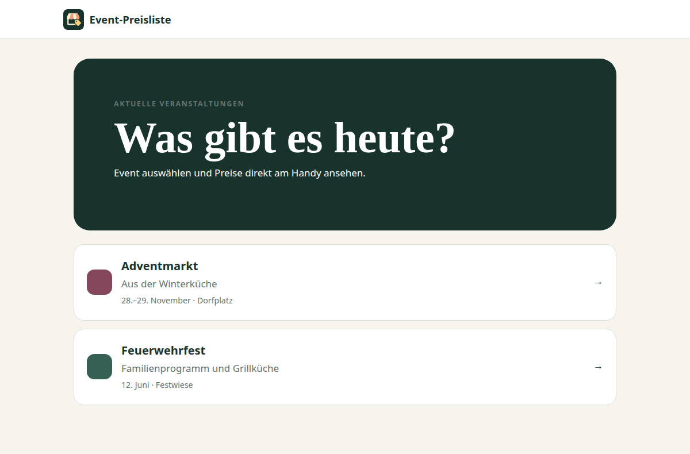
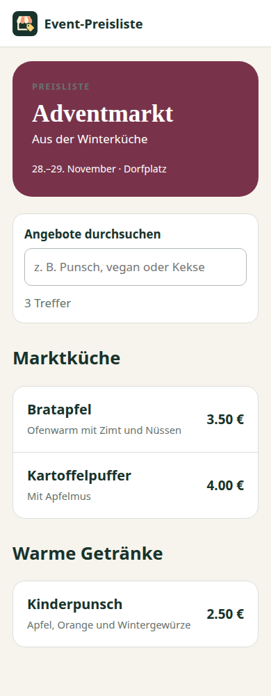
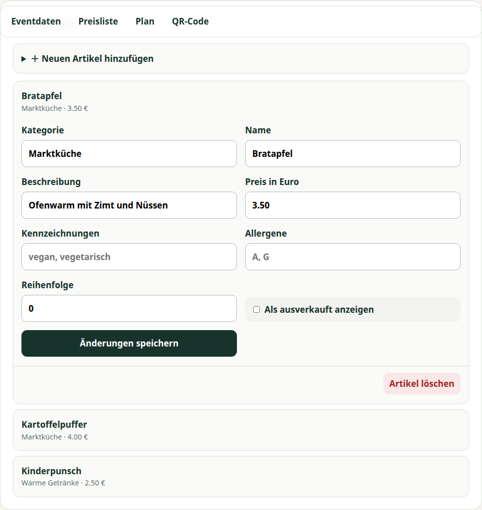

# Event-Preisliste

Eine selbst gehostete, mobilfreundliche Preisliste für Adventmärkte, Feuerwehrfeste, Vereinsfeste und andere Veranstaltungen. Für jedes Event wird eine eigene öffentliche Seite mit QR-Code erzeugt.

**[CasaOS-Installation](INSTALLATION.md)** · **[CasaOS-YAML direkt öffnen](https://raw.githubusercontent.com/ThomS263/event-preisliste/v0.4.2/Apps/EventPreisliste/docker-compose.yml)**

## Ein Blick in die App



Die Handyansicht zeigt die Angebote für Gäste. Im Admin-Panel können Veranstalter Preise und Kennzeichnungen bearbeiten. Beide Aufnahmen zeigen Beispieldaten.

<a href="docs/screenshots/handy.png"></a>
<a href="docs/screenshots/verwaltung.png"></a>

## Funktionen

- mehrere Veranstaltungen getrennt verwalten
- Titel, Untertitel, Datum, Ort und Farbe pro Event
- Artikel nach Kategorien mit Beschreibung und Europreis
- Event zunächst als Entwurf vorbereiten und später veröffentlichen
- eigener QR-Code zum Herunterladen und Ausdrucken
- interaktiver Geländeplan mit hochgeladenem Planbild und anklickbaren Punkten für Stände, Essen, Getränke, WC, Eingang, Information und Erste Hilfe
- große, schnelle Handyansicht ohne App und ohne externe Schriftarten
- persistente SQLite-Daten im Docker-Volume
- Adminbereich mit Passwort, Same-Origin-Schutz und Sicherheitsheadern
- zentrales Admin-Panel mit Übersicht, Eventbearbeitung, Öffnungszeiten, Preisbearbeitung, Ausverkauft-Status, Kennzeichnungen und Allergenen
- Artikelsuche, installierbare PWA und Offline-Zwischenspeicher
- zeitgesteuerte Veröffentlichung und Eventvorlagen zum Duplizieren
- CSV-Import/-Export und ZIP-Sicherung
- Adminpasswortwechsel, Login-Rate-Limit und automatische Sicherheitsprüfungen
- Docker-Healthcheck und eingeschränkte Containerrechte

## Schnellstart

```bash
git clone https://github.com/ThomS263/event-preisliste.git
cd event-preisliste
cp .env.example .env
# In .env unbedingt ein eigenes starkes Adminpasswort setzen.
docker compose up -d --build --wait
```

Danach `http://SERVER-IP:8090/admin/login` öffnen, anmelden und das erste Event erstellen. Für korrekte QR-Codes außerhalb des Heimnetzes in `.env` eine erreichbare HTTPS-Adresse als `EVENT_PUBLIC_URL` eintragen.

## Aktualisieren

```bash
cd event-preisliste
git pull --ff-only origin main
docker compose up -d --build --wait
```

Die Daten liegen im lokalen Verzeichnis `data/` und bleiben bei Updates erhalten. Vor Updates diesen Ordner sichern.

## CasaOS

Die fertige CasaOS-Konfiguration verwendet das veröffentlichte Multi-Arch-Image für AMD64 und ARM64. Sie legt eine App-Kachel auf Port 8090 an und speichert alle Daten dauerhaft unter `/DATA/AppData/event-preisliste/data`. Die genaue Schritt-für-Schritt-Anleitung steht in [INSTALLATION.md](INSTALLATION.md).

## Entwicklung und Tests

```bash
python3 -m venv .venv
. .venv/bin/activate
pip install -r requirements-dev.txt
pytest -q
```

## Interaktiven Plan einrichten

1. Veranstaltung in der Verwaltung öffnen.
2. Unter **Interaktiver Plan** ein PNG-, JPEG- oder WebP-Bild bis 2 MB hochladen.
3. Auf die gewünschte Position im Plan tippen.
4. Name, Art und Beschreibung eingeben und **Punkt hinzufügen** wählen.
5. Auf der öffentlichen Eventseite können Gäste die nummerierten Punkte antippen.

## Admin-Panel

Unter `/admin/login` werden alle Veranstaltungen zentral verwaltet. Das Dashboard zeigt Events, veröffentlichte Events, Artikel und Planpunkte. In jedem Event gibt es Bereiche für Eventdaten, Preise, Plan und QR-Code. Artikel können nachträglich geändert, als ausverkauft markiert und mit Kennzeichnungen wie `vegan` sowie Allergencodes versehen werden.

## Geplante nächste Schritte

- Events und bestehende Artikel vollständig bearbeiten
- Artikel als „ausverkauft“ markieren
- optionale Bilder und Logos pro Event
- mehrsprachige Preislisten
- Druckansicht für QR-Code-Schilder
- CasaOS-Installationspaket

## Lizenz

GNU Affero General Public License v3.0 (`AGPL-3.0-only`).
